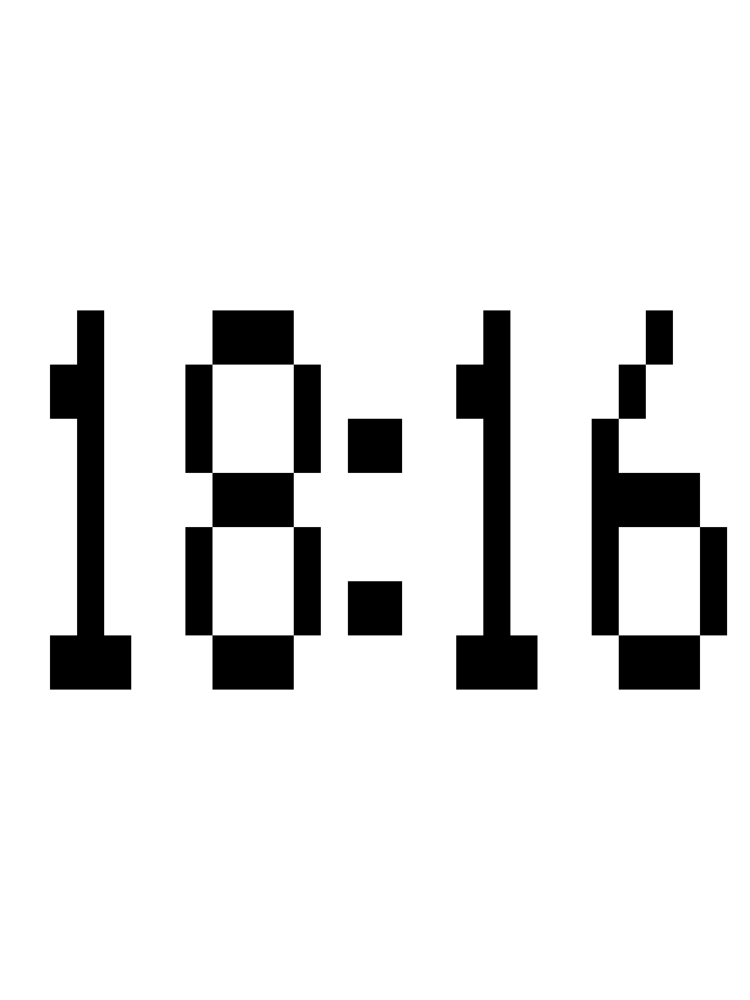
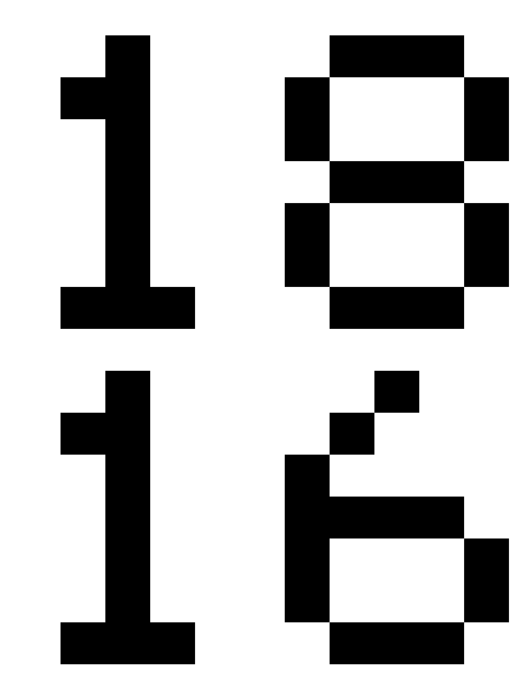
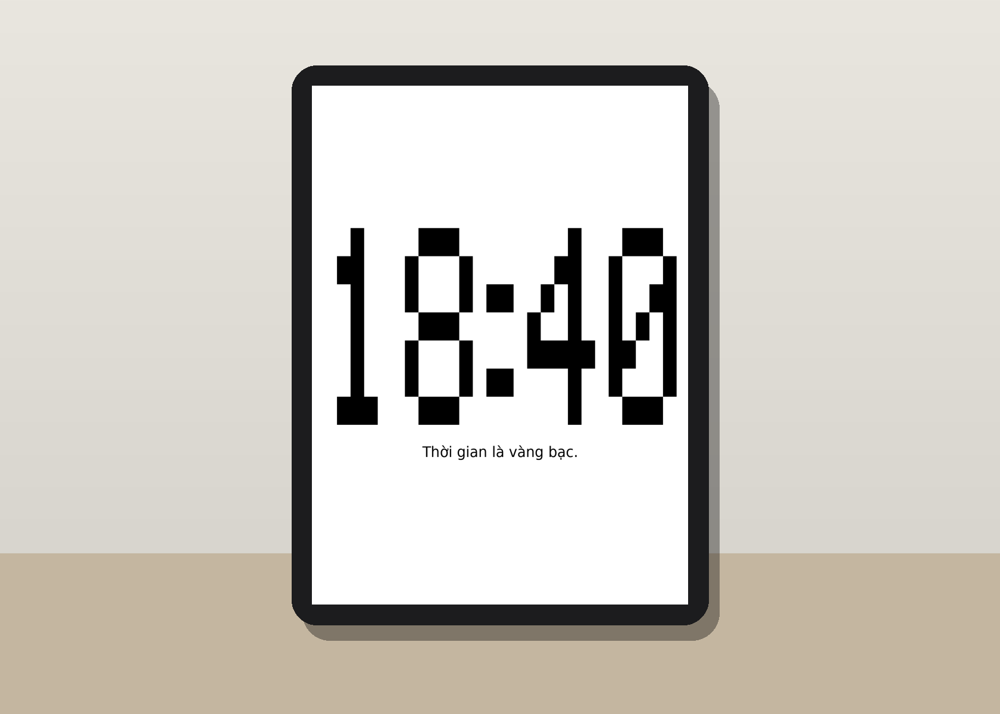
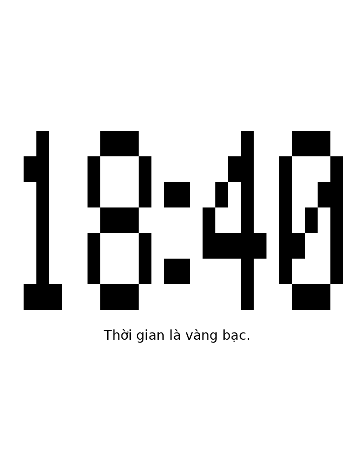

**Tiếng Việt** · [English](README.md)

# Kobo Sage Clock


Biến chiếc máy đọc sách **Kobo Sage** thành một chiếc **đồng hồ pixel để
bàn**. Plugin này trả lời đúng một nhu cầu:

> *Máy đọc sách để trên bàn cả ngày — sao màn hình e-ink đẹp thế mà lúc rảnh
> lại không hiện gì hữu ích?*

Khi Sage Clock chạy, toàn bộ màn hình 1440×1920 chỉ hiện:

1. **Giờ giấc — chỉ giờ và phút** (`HH:MM`), bằng số pixel tự vẽ thật to,
   nhìn rõ từ xa.
2. **Một câu thành ngữ/câu hay về thời gian** ở bên dưới, chữ thường nhỏ,
   mỗi nhịp cập nhật lại đổi câu khác.
3. **Không gì thêm.** Không ngày tháng, không giây, không phần trăm pin.

| Kiểu ngang | Kiểu dọc (giờ trên, phút dưới) |
| --- | --- |
|  |  |

## Hình ảnh



Cứ 2 phút đồng hồ vẽ lại — giờ mới, câu thành ngữ tiếp theo:



Ảnh chụp màn hình độ phân giải đầy đủ (1440×1920, đúng như Sage hiển thị):
[kiểu ngang](docs/preview-ngang.png) · [kiểu dọc](docs/preview-doc.png)

## Cài đặt nhanh

> Hướng dẫn đầy đủ từng bước, có xử lý sự cố: **[INSTALL.md](INSTALL.md)**

1. Tải repo này dạng ZIP (**Code → Download ZIP**) rồi giải nén.
2. Cắm Sage qua USB, chép thư mục **`sageclock.koplugin`** vào
   **`.adds/koreader/plugins/`** trên máy.
3. Rút cáp an toàn, khởi động lại KOReader **thật sự**, rồi mở
   **Menu ☰ → Công cụ (Tools) → Sage Clock — đồng hồ → Hiện đồng hồ**.

Yêu cầu: Kobo Sage **đã cài sẵn [KOReader](https://koreader.rocks)**.
Khi đồng hồ đang chạy, chạm hoặc vuốt vào màn hình để thoát về đọc sách.


## Hai kiểu hiển thị

| Kiểu | Cỡ ô pixel (trên Sage) | Hợp với |
| --- | --- | --- |
| **Ngang** `18:40` | ≈ 52×104 px | Dáng đồng hồ cổ điển; còn chỗ cho dòng thành ngữ bên dưới |
| **Dọc** — giờ ở dòng trên, phút ở dòng dưới | ≈ 123×97 px, số cao gần gấp đôi | Nhìn giờ từ xa; dòng thành ngữ vẫn vừa bên dưới |

Đổi kiểu trong **Menu → Công cụ → Sage Clock → Kiểu dọc: giờ trên, phút dưới**.

## Dòng thành ngữ xoay vòng

Mỗi nhịp cập nhật, dòng chữ dưới đồng hồ chuyển sang câu tiếp theo trong
thư viện **80 câu có sẵn** — thành ngữ, tục ngữ, ca dao Việt Nam về thời
gian cộng với các câu danh ngôn tiếng Anh kinh điển. Vài câu tiêu biểu:

- *Thời gian là vàng bạc.*
- *Có công mài sắt, có ngày nên kim.*
- *Thì giờ thấm thoắt thoi đưa.*
- *Don't count the days, make the days count. — Ali*
- *Lost time is never found again. — Franklin*
- *Carpe diem. — Horace*

Cách xoay không cần lưu trạng thái: plugin chọn câu theo
`floor(thời_gian_unix / 120) mod 80`, nên câu đổi đúng lúc đồng hồ vẽ lại,
một vòng đủ 80 câu kéo dài 160 phút, và hai máy chạy Sage Clock cùng lúc sẽ
hiện cùng một câu. Muốn tắt dòng này:
**Menu → Công cụ → Sage Clock → Hiện câu thành ngữ dưới đồng hồ**.

## Cách hoạt động

### Vì sao phải là plugin, không dùng màn hình ngủ có sẵn?

Màn hình ngủ (sleep screen) của Kobo chỉ là **ảnh tĩnh**, còn khi ngủ sâu thì
CPU dừng hẳn — không ảnh chờ nào tự đổi phút được. Sage Clock chạy trong
KOReader và **giữ máy thức**, vẽ lại màn hình e-ink theo lịch. Khi mở đồng
hồ, nó yêu cầu KOReader chặn chế độ chờ và tắt tự ngủ
(`UIManager:preventStandby()` / `UIManager:stopAutoSuspend()`, bọc trong
`pcall` để bản KOReader nào thiếu một trong hai hàm cũng không làm sập
plugin); khi thoát thì trả lại cả hai.

### Lịch cập nhật

- Lần vẽ tiếp theo được hẹn bằng `UIManager:scheduleIn()` tới **mốc phút
  chẵn tiếp theo**: `delay = 120 − (now mod 120) + 1` giây (cộng thêm 1 giây
  đệm để chắc chắn đồng hồ hệ thống đã nhảy phút).
- Mỗi nhịp, plugin chỉ dựng lại widget khi chữ `HH:MM` đã đổi, và yêu cầu
  làm mới thường (`ui`) — riêng **mỗi 10 lần đổi (20 phút)** làm mới
  **toàn phần** một lần để xóa bóng ma e-ink.
- Hệ quả cố ý: **giờ hiển thị có lúc chậm 1 phút**, vì các phút lẻ không bao
  giờ được hiện.

### Số pixel

Số không phải font chữ. Mỗi ký tự là một bitmap cứng **5 cột × 7 hàng**
(`#` = ô đen, dấu `:` rộng 2 cột) trong bảng `GLYPHS` ở `main.lua`, được vẽ
từng ô bằng `Blitbuffer:paintRect()`. Không phụ thuộc font nào của máy, máy
nào hiện cũng giống nhau. Cỡ ô tính theo kích thước màn hình thật:

- Kiểu ngang: `cell_w = floor(rộng × 0.94 / 26)` (26 = tổng số cột của
  `HH:MM` tính cả khoảng cách), `cell_h = min(floor(cao × 0.55 / 7), 2 × cell_w)`.
- Kiểu dọc: `cell_w = floor(rộng × 0.94 / 11)`,
  `cell_h = floor(cao × 0.76 / 15)` khi bật thành ngữ (`0.90` khi tắt).

## Cấu hình

Không có file cấu hình — hai tùy chọn nằm trong cài đặt của KOReader, bật/tắt
từ **Menu → Công cụ → Sage Clock**:

| Tùy chọn trong menu | Khóa cài đặt | Mặc định | Tác dụng |
| --- | --- | --- | --- |
| Kiểu dọc: giờ trên, phút dưới | `sageclock_stacked` | tắt | Chuyển giữa kiểu ngang và kiểu dọc |
| Hiện câu thành ngữ dưới đồng hồ | `sageclock_quote` | **bật** | Hiện/ẩn dòng thành ngữ xoay vòng |
| Cỡ chữ (Nhỏ/Vừa/Lớn) | `sageclock_size` | Vừa | Phóng to/thu nhỏ cả số pixel lẫn dòng thành ngữ |

Cả hai có hiệu lực từ lần mở đồng hồ tiếp theo.

## Pin & các đánh đổi

- CPU thức suốt lúc đồng hồ chạy nên pin tốn **hơn ngủ sâu rất nhiều** —
  phần vẽ e-ink (mỗi 2 phút làm mới một phần) mới là phần rẻ. Mức hao pin
  thực tế trên Sage chưa được đo; ai đo được xin báo qua Issues.
- Để làm đồng hồ bàn hoặc để qua đêm, **nên cắm sạc USB-C**.
- Đèn nền giữ nguyên theo cài đặt KOReader của bạn — tắt đèn cho dáng e-ink
  thuần nhất, hoặc để đèn ấm mức thấp làm đồng hồ đêm.
- Thoát đồng hồ (chạm/vuốt) là máy trở lại chế độ ngủ bình thường ngay.

## Cấu trúc dự án

```
kobo-sage-clock/
├─ README.md                  ← bản tiếng Anh
├─ README.vi.md               ← bạn đang đọc
├─ INSTALL.md                 ← hướng dẫn cài đặt chi tiết (tiếng Việt)
├─ CHANGELOG.md
├─ LICENSE                    ← MIT
├─ docs/
│  ├─ preview-ngang.svg       ← ảnh xem trước kiểu ngang (vector)
│  ├─ preview-doc.svg         ← ảnh xem trước kiểu dọc (vector)
│  ├─ preview-ngang.png       ← ảnh chụp đầy đủ kiểu ngang (1440×1920)
│  ├─ preview-doc.png         ← ảnh chụp đầy đủ kiểu dọc
│  ├─ mockup-desk.png         ← hình dựng máy trên bàn
│  └─ rotation.gif             ← ảnh động: xoay vòng giờ + thành ngữ
└─ sageclock.koplugin/        ← chép thư mục này vào .adds/koreader/plugins/
   ├─ _meta.lua               ← thông tin plugin (tên, phiên bản)
   └─ main.lua                ← toàn bộ plugin: bảng số pixel, widget, lịch vẽ
```

## Cho người muốn sửa code

Plugin là một file Lua duy nhất, tự chứa, không phụ thuộc gì ngoài KOReader.

- **Kiểm tra cú pháp** (LuaJIT chính là runtime của KOReader):
  `luajit -bl sageclock.koplugin/main.lua`
- **Đổi nhịp cập nhật:** sửa số `120` trong `ClockWidget:scheduleTick()`
  (`delay = 120 − (now_s % 120) + 1`) *và* số `120` tương ứng trong
  `currentQuote()` để dòng thành ngữ đổi cùng nhịp.
- **Sửa/thêm câu thành ngữ:** sửa bảng `QUOTES` gần đầu `main.lua`. Giữ câu
  ngắn — câu dài sẽ xuống hai dòng và làm số ở kiểu dọc nhỏ lại.
- **Đổi dáng số:** sửa các bitmap trong bảng `GLYPHS` (mỗi số 5×7, dấu `:`
  rộng 2 cột).
- Sửa xong chép lại thư mục `sageclock.koplugin` vào máy và khởi động lại
  KOReader thật sự.

## Hạn chế đã biết

- Chỉ hiện **giờ và phút** — đúng thiết kế: không giây, không ngày tháng, và
  với nhịp 2 phút thì phút có thể chậm 1 so với giờ thật.
- Không phải màn hình ngủ thật: chỉ chạy khi KOReader đang mở và đồng hồ đã
  được bật. Bấm nút nguồn thì máy vẫn ngủ với màn hình ngủ thường của
  Kobo/KOReader.
- Thiết kế và căn chỉnh cho màn 1440×1920 của Sage; máy Kobo khác chạy được
  về nguyên tắc (cỡ chữ tự tính theo màn hình) nhưng chưa kiểm chứng.
- Thành ngữ hiện chỉ có tiếng Việt.
- Chưa đo mức hao pin khi chạy đồng hồ.

## Xử lý sự cố

| Hiện tượng | Cách xử lý |
| --- | --- |
| Không thấy mục **Sage Clock** trong menu Công cụ | Chưa khởi động lại KOReader thật sự sau khi chép, hoặc chép sai chỗ — đường dẫn đúng: `.adds/koreader/plugins/sageclock.koplugin/main.lua` |
| Đồng hồ hiện sai giờ | Chỉnh lại giờ và múi giờ trong **Settings của Kobo** → Date and time (không phải trong KOReader) |
| Giờ chậm 1 phút | Đúng thiết kế — đồng hồ chỉ vẽ ở mốc phút chẵn |
| Không thấy dòng thành ngữ | Tùy chọn **Hiện câu thành ngữ dưới đồng hồ** đang tắt — bật lên rồi mở lại đồng hồ |
| KOReader báo lỗi khi mở đồng hồ | Lấy file `crash.log` trong `.adds/koreader` và mở Issue kèm file đó |
| Số bị bóng ma sau nhiều giờ | Hiện tượng thường của e-ink; plugin đã tự làm mới toàn phần mỗi 20 phút — thoát ra mở lại đồng hồ cũng ép làm mới toàn phần |

## Trạng thái & phiên bản

- **Phiên bản 2.2.0** — thư viện câu hay mở rộng lên 80 câu Việt–Anh (xem
  [CHANGELOG.md](CHANGELOG.md)).
- Đã kiểm tra cú pháp bằng LuaJIT 2.1; **chưa chạy thử dài hạn trên máy Sage
  thật**. Rất hoan nghênh báo lỗi và kết quả chạy thử qua Issues.

## Giấy phép

MIT — xem file [LICENSE](LICENSE).
